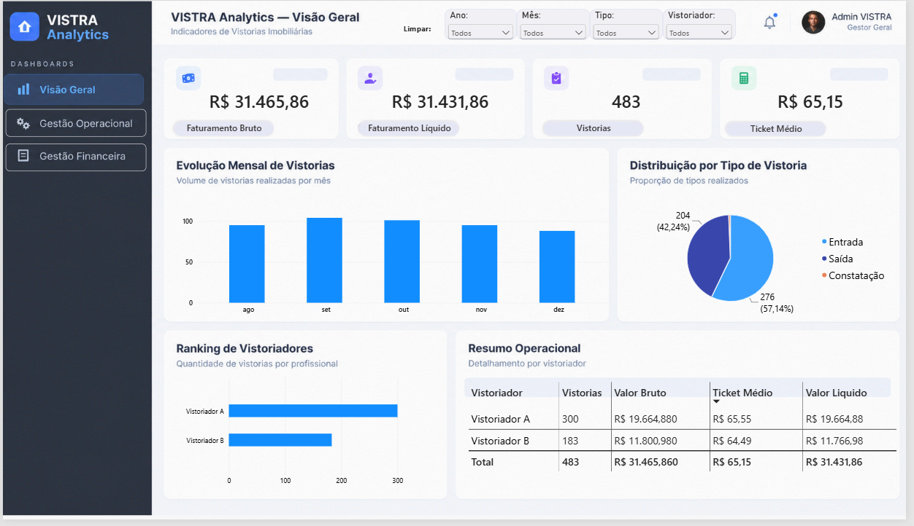
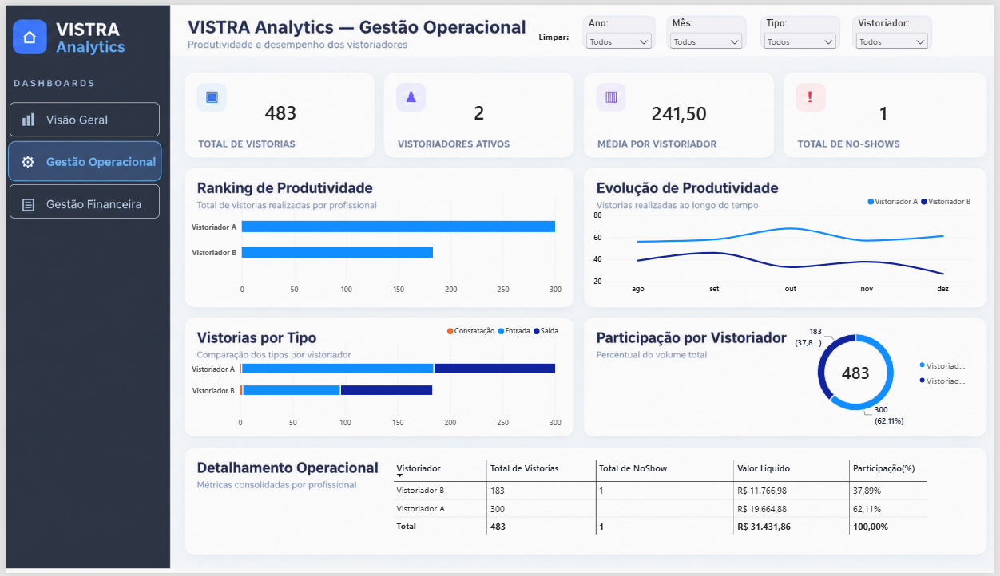
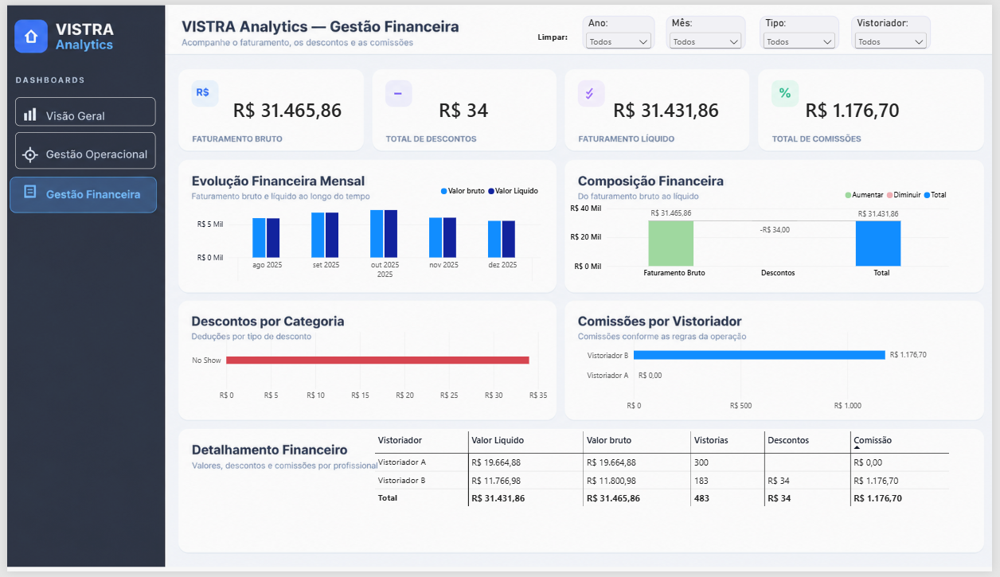

# VISTRA Analytics — Gestão de Vistorias Imobiliárias

**Dashboard de Business Intelligence desenvolvido em Power BI** para análise de produtividade, vistorias e resultados financeiros de uma operação imobiliária.


> **Projeto demonstrativo com identificações substituídas.** Os nomes dos vistoriadores foram trocados por *Vistoriador A* e *Vistoriador B*. Os indicadores representam o recorte analisado. Os dados exibidos foram pseudonimizados; não se afirma anonimização irreversível de todas as fontes. O arquivo `.pbix` e os PDFs originais **não estão incluídos** neste repositório.

## Sobre o projeto

O VISTRA Analytics surgiu da necessidade de reunir e analisar informações de vistorias imobiliárias originalmente distribuídas em **relatórios PDF de diferentes períodos**. Os dados foram extraídos e tratados no Power Query, estruturados em um modelo analítico e utilizados em três páginas interativas do Power BI.

### Indicadores do recorte demonstrado

| Indicador | Resultado |
| --- | ---: |
| Vistorias registradas | **483** |
| Vistoriadores | **2** |
| Faturamento bruto | **R$ 31.465,86** |
| Descontos registrados | **R$ 34,00** |
| Faturamento líquido | **R$ 31.431,86** |
| Comissão gerada pela produção do Vistoriador B | **R$ 1.176,70** |
| Ocorrências de no-show | **1** |

*Valores referentes à seleção exibida nas capturas, de agosto a dezembro de 2025. Não são valores projetados nem representam atualização em tempo real.*

## O desafio de negócio

Relatórios de vistorias apresentados separadamente dificultam o acompanhamento consolidado da quantidade de atendimentos, do desempenho por profissional, dos descontos e do resultado financeiro. O objetivo do projeto foi criar um ambiente de análise visual, com dados comparáveis ao longo do tempo e critérios de cálculo verificáveis.

## Dashboard: três páginas interativas

### 1. Visão Geral

Visão executiva com faturamento bruto e líquido, volume de vistorias, ticket médio, evolução mensal, distribuição por tipo, ranking de vistoriadores e resumo operacional.



### 2. Gestão Operacional

Análise de produtividade por vistoriador, evolução mensal individual, divisão por tipo de vistoria, participação percentual, no-shows e detalhamento operacional.



### 3. Gestão Financeira

Comparação mensal entre valores brutos e líquidos, composição financeira, valores de desconto por categoria, comissões geradas pela produção dos profissionais e matriz de detalhamento financeiro.



## Tecnologias e competências demonstradas

| Recurso | Aplicação |
| --- | --- |
| **Power BI Desktop** | Desenvolvimento de três páginas e visuais interativos |
| **Power Query** | Extração, limpeza, padronização e consolidação de dados de PDFs |
| **DAX** | Indicadores, médias, participação percentual, descontos e regras de comissão |
| **Modelagem de dados** | Tabela calendário, dimensão de vistoriadores e relacionamentos com as tabelas operacionais |
| **UX Pilot** | Referências de layout e identidade visual posteriormente reproduzidas no Power BI |
| **Bookmarks e botões** | Navegação e restauração das seleções de filtros |

## Etapas do desenvolvimento

1. **Obtenção dos dados:** identificação das tabelas relevantes dos relatórios PDF.
2. **ETL no Power Query:** padronização de nomes e tipos de dados, combinação de períodos e organização das ocorrências de desconto.
3. **Modelagem:** organização das tabelas de relatórios, descontos, calendário e dimensão de vistoriadores.
4. **Medidas DAX:** cálculo de faturamento, descontos, volume, participação e comissões por regras de negócio.
5. **Interface:** desenho de uma identidade SaaS de tema claro e implementação de três páginas.
6. **Interatividade:** segmentações sincronizadas, navegação pelo menu lateral, interação cruzada dos visuais e limpeza de filtros via bookmarks.
7. **Validação:** conferência dos valores e cálculos ao selecionar cada vistoriador.

## Regra de negócio em destaque: comissão

No caso demonstrado, a comissão corresponde a **10% do valor líquido da produção do Vistoriador B**, calculado após os descontos aplicáveis. A atribuição da produção e o beneficiário da comissão são conceitos distintos: o gráfico apresenta quem **gerou** a comissão.

Uma versão ilustrativa da medida utilizada no relatório pseudonimizado:

```dax
Comissao Gerada =
SUMX(
    VALUES('Dim_Vistoriadores'[Vistoriador]),
    VAR Profissional = 'Dim_Vistoriadores'[Vistoriador]
    RETURN
        IF(
            Profissional = "Vistoriador B",
            [Valor Liquido] * 0.10,
            0
        )
)
```

O exemplo pressupõe as medidas e relacionamentos empregados no modelo. A formatação monetária é aplicada no Power BI. Veja as explicações em [Documentação técnica](docs/arquitetura-e-medidas.md).

## Recursos de usabilidade

- Navegação entre **Visão Geral**, **Gestão Operacional** e **Gestão Financeira**.
- Segmentações por ano, mês, tipo de vistoria e vistoriador, sincronizadas conforme a página.
- Interações entre gráficos, cartões e matrizes para exploração por profissional.
- Botões de **limpar filtros** com bookmarks.
- Identidade visual consistente, com menus laterais e painéis de leitura rápida.

## Resultados e aprendizados

O projeto demonstra o processo completo de criação de um produto de BI: preparação e transformação dos dados, modelagem, indicadores DAX, visualização, testes de filtros, revisão visual e documentação. O modelo permitiu analisar **483 vistorias**, comparar dois profissionais e conferir o resultado financeiro do recorte exibido.

**Não foram medidos nem reivindicados** ganhos percentuais de produtividade, redução de custos ou economia de horas.

## Estrutura do repositório

```text
VISTRA_Analytics_Portfolio/
├── README.md
├── assets/
│   ├── visao-geral.png
│   ├── gestao-operacional.png
│   └── gestao-financeira.png
└── docs/
    ├── arquitetura-e-medidas.md
    ├── checklist-publicacao.md
    └── como-publicar-no-github.md
```

## Reprodutibilidade e privacidade

As capturas permitem avaliar a interface e os resultados apresentados. O modelo `.pbix` e os dados de origem não estão incluídos neste pacote. Antes de compartilhar uma versão executável, é necessário fazer uma verificação adicional das consultas M, caminhos das fontes, tabelas ocultas, informações embutidas e riscos de reidentificação. Consulte o [checklist de publicação](docs/checklist-publicacao.md).

---

**Projeto de portfólio — Power BI · Power Query · DAX · Business Intelligence**
